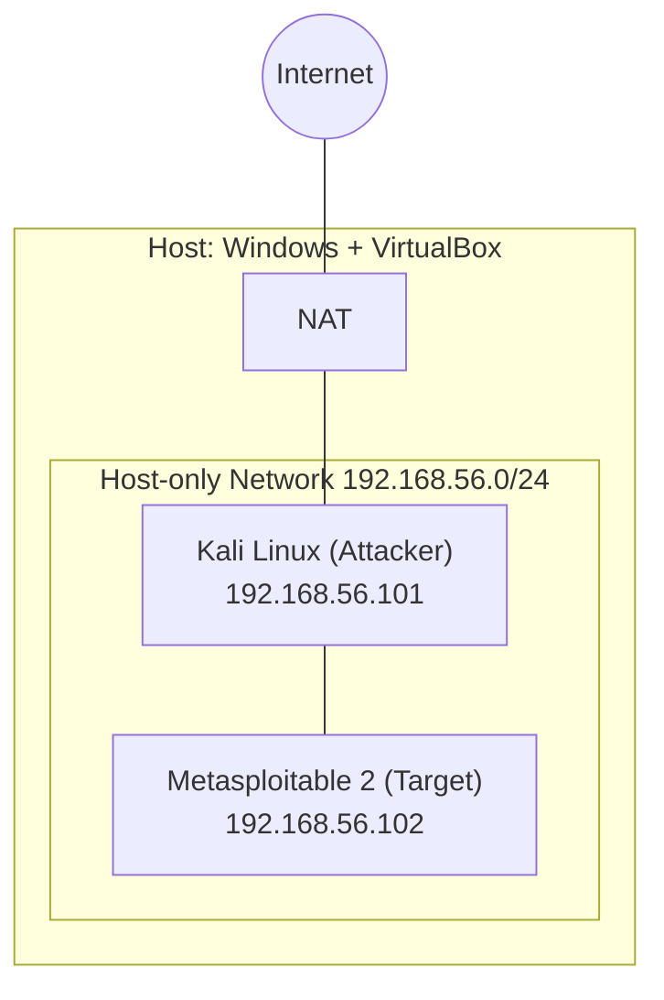

# Lab 1: สร้าง Home Lab สำหรับฝึก Cyber Security

## วัตถุประสงค์
สร้างสภาพแวดล้อมจำลองที่ปลอดภัยบนเครื่องของตัวเอง เพื่อใช้ฝึกสแกนเครือข่าย วิเคราะห์ Traffic และตั้งค่า Firewall ใน Lab ถัดไป โดยไม่กระทบเครือข่ายจริง

## สภาพแวดล้อม
| รายการ | รายละเอียด |
|---|---|
| เครื่องหลัก (Host) | [Windows 11 / RAM 16 GB / CPU 11th GEN Intel Core I5-11400H] |
| โปรแกรม Virtualization | VirtualBox 7.2.22 |
| เครื่องโจมตี (Attacker) | Kali Linux 2026.3 |
| เครื่องเป้าหมาย (Target) | [Ubuntu Server / Metasploitable 2] |
| รูปแบบเครือข่าย | Host-only Network [ช่วง IP เช่น 192.168.56.1/24] |

## ผังเครือข่าย


เครื่อง Kali และเครื่องเป้าหมายอยู่ในเครือข่าย Host-only เดียวกัน คุยกันเองได้ แต่แยกออกจากเครือข่ายภายนอก

## ขั้นตอน

### 1. ติดตั้ง VirtualBox
ดาวน์โหลดจากเว็บไซต์ทางการและติดตั้งตามค่าเริ่มต้น

### 2. สร้าง Host-only Network
- File → Tools → Network Manager → สร้าง Host-only Network
- ตั้งค่า IP ของ Adapter เป็น `[192.168.56.1]`

### 3. ติดตั้ง Kali Linux
- Import ไฟล์ VM สำเร็จรูป (หรือติดตั้งจาก ISO)
- กำหนด RAM [2 GB], CPU [2 core]
- ตั้ง Network Adapter เป็น Host-only

### 4. ติดตั้งเครื่องเป้าหมาย
- [ขั้นตอนติดตั้ง Ubuntu Server / Metasploitable]
- ตั้ง Network Adapter เป็น Host-only เช่นกัน

### 5. ตรวจสอบการเชื่อมต่อ
```bash
# ดู IP ของเครื่องตัวเอง
ip a

# ทดสอบ ping ไปยังเครื่องเป้าหมาย
ping -c 4 [IP เครื่องเป้าหมาย]
```

## ผลลัพธ์


- Kali ได้รับ IP `[192.168.56.101]`
- เครื่องเป้าหมายได้รับ IP `[192.168.56.102]`
- Ping สำเร็จทั้งสองทิศทาง แสดงว่าเครือข่ายทำงานถูกต้อง

## สิ่งที่ได้เรียนรู้
- เข้าใจความแตกต่างระหว่าง NAT, Bridged และ Host-only Network
- รู้วิธีแยก Lab ออกจากเครือข่ายจริงเพื่อความปลอดภัย
- ได้ทดลองใช้ Kali
- รู้จักกับ Metasploit2

## ขั้นตอนต่อไป
นำสภาพแวดล้อมนี้ไปใช้ใน [Lab 2: Nmap Scan](../02-nmap-scan/)
